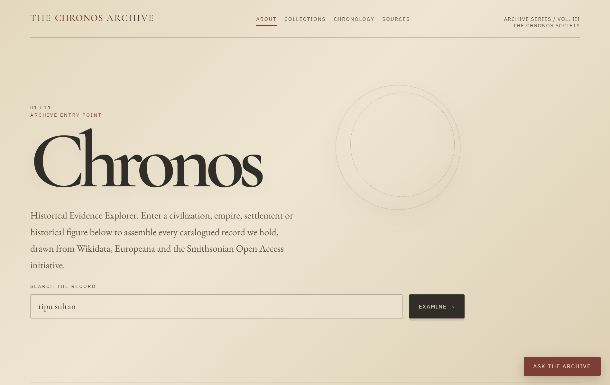
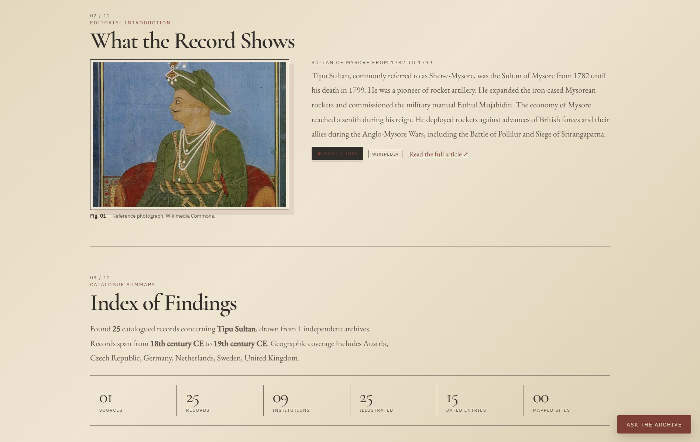
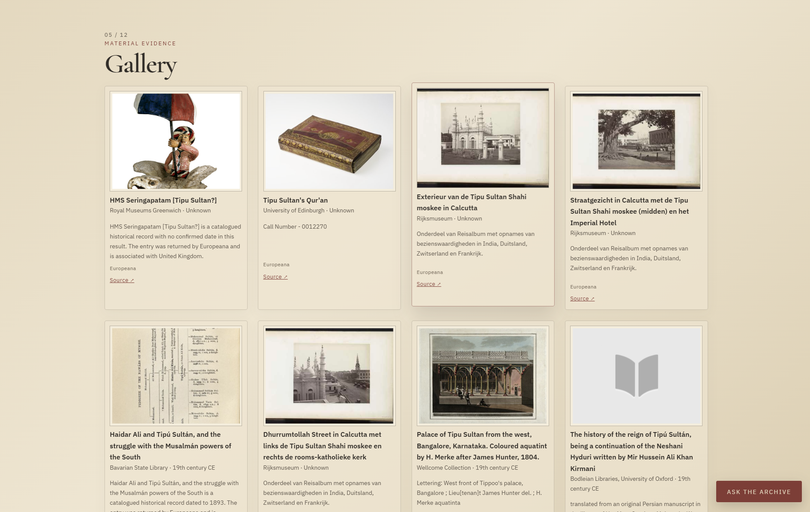
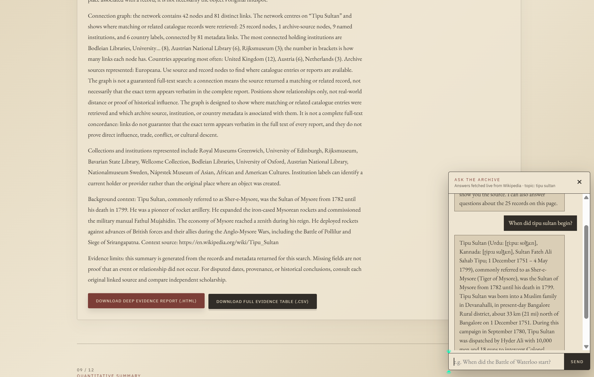

# The Chronos Archive

### [EXPLORE THE LIVE PROJECT →](https://chronos-rag.netlify.app/)

**Historical Evidence Explorer**

A browser-based historical research tool that brings together records from Europeana, Wikidata, Smithsonian and Wikipedia. Search historical topics, explore connected records, view timelines and maps, and access information linked to its original sources.


---

## Overview

Chronos is designed to make historical research easier by collecting information from multiple open-access archives in one place.

Enter a civilization, empire, historical event, settlement or historical figure, and the application searches available sources to build an interactive collection of historical records.

The project focuses on presenting sourced information rather than generating historical answers using AI. Each record links back to its original source so users can explore and verify the information themselves.

## Features



### 1. Historical Search and Archive Records

Search for historical topics and retrieve records from Europeana, Wikidata and the Smithsonian. Results are combined into a unified catalogue with descriptions, images, dates and links to their original sources.



### 2. Interactive Timeline

Historical records with date information are displayed on an interactive SVG timeline. Users can explore the chronological order of events and select entries to view additional details and related information.


### 3. Historical Gallery

Browse retrieved archive records through an image-based gallery. Each entry includes available descriptions, images and links to the original archive.

The gallery also supports lazy loading and progressive loading of additional records.



### 4. Geographic Map

Records containing geographic coordinates are displayed on an interactive Leaflet map. This allows users to explore historical locations, findspots and holding institutions.

Selecting a map marker displays additional information and source links.


### 5. Connection Graph

The connection graph uses vis-network to display relationships between historical records, archive sources, museums, institutions and countries.

Users can explore how different records are connected and select individual nodes to understand their relationships.


### 6. Ask the Archive

A Wikipedia-powered chatbot that answers historical questions using live sentence extraction and relevance scoring.

It can also answer questions about the currently displayed records, including earliest and latest entries, record counts, institutions and countries.

The chatbot does not require an external AI model or paid API.

### 7. Deep Evidence Report

Chronos combines information from the retrieved records into an integrated research report.

It includes record counts, image coverage, chronology, geographic information and connection graph analysis.

Reports can be downloaded in HTML and CSV formats for further reference.



### 8. Text-to-Speech

The Web Speech API provides browser-based narration, allowing users to listen to available historical information instead of reading everything on screen.

---

## Data Sources

| Source | Purpose | Access |
|---|---|---|
| [Europeana](https://www.europeana.eu/) | Historical archive records and media | Demo API key |
| [Wikidata](https://www.wikidata.org/) | Structured historical information | Public SPARQL endpoint |
| [Wikipedia](https://www.wikipedia.org/) | Historical context and chatbot responses | Public APIs |
| [Smithsonian Open Access](https://www.si.edu/openaccess) | Museum records and collections | API key |

All retrieved records retain links to their original sources.

## Project Structure

```text
chronos-netlify/
├── index.html
├── app.js
├── styles.css
├── netlify.toml
│
├── chronos/
│   ├── result.png
│   ├── result2.png
│   ├── result3.png
│   └── result4.png
│
├── netlify/
│   └── functions/
│       ├── smithsonian.js
│       └── smithsonian.mjs
│
└── README.md
```

## Getting Started

### Prerequisites

- A modern web browser.
- Node.js (optional, for local development).
- A Smithsonian API key (optional).

### Run Locally

Chronos does not require a build process.

You can start a local server using:

```bash
npx http-server . -p 8888
```

Then open:

```text
http://localhost:8888
```

To run the Netlify serverless functions locally, use the Netlify CLI:

```bash
npm install -g netlify-cli
netlify dev
```

### Environment Variables

| Variable | Required | Description |
|---|---|---|
| `SMITHSONIAN_API_KEY` | Optional | API key for Smithsonian Open Access. |

You can obtain a free API key from [api.data.gov](https://api.data.gov/signup/).

For deployment, add the key under your Netlify site's environment variables. For local development, use a `.env` file with Netlify CLI.

Do not upload your actual `.env` file or API credentials to GitHub.

## Deployment

### Netlify

1. Push the project repository to GitHub.
2. Connect the repository to [Netlify](https://app.netlify.com/).
3. Set the publish directory to `.`.
4. Configure the `SMITHSONIAN_API_KEY` environment variable if required.
5. Deploy the project.

The existing `netlify.toml` contains the deployment configuration:

```toml
[build]
  publish = "."
  functions = "netlify/functions"

[functions]
  node_bundler = "esbuild"
```

Other static hosting platforms can also host the frontend. However, the Smithsonian serverless function is configured specifically for Netlify and would need adaptation for other platforms.

## Tech Stack

| Component | Technology |
|---|---|
| Frontend | HTML5, CSS3, JavaScript |
| Maps | Leaflet |
| Graph Visualization | vis-network |
| Historical Data | Europeana, Wikidata, Smithsonian |
| Historical Context | Wikipedia APIs |
| Chatbot | Wikipedia sentence extraction and relevance scoring |
| Reports | HTML and CSV |
| Text-to-Speech | Web Speech API |
| Serverless Functions | Netlify Functions |
| Deployment | Netlify |

## License

© 2026 — All rights reserved.

## Author

**Muhamed Nabhan**

- [LinkedIn](https://linkedin.com/in/muhamed-nabhan)
- [Portfolio](https://muhamed-nabhan.netlify.app/)
- [Resume](https://drive.google.com/file/d/1GwRfg-8FNkmGJ2ACoJMqRs_iR7vA0tXN/view?usp=drive_link)
